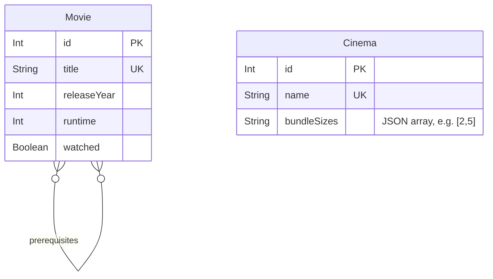

# Doomsday Ready

A small full-stack app for planning an MCU rewatch before *Avengers: Doomsday* and finding the fewest cinema bundles for a group. Built for the Blinto Full Stack Developer Internship assessment.

## Features

- **Movies:** add movies, edit prerequisites, mark watched.
- **Rewatch plan:** prerequisite order, watched progress, remaining runtime.
- **Cinema booking:** exact bundle combination with the minimum number of bundles.

## Tech Stack

Next.js 16, React 19, TypeScript, Prisma 6 with SQLite, Zod 4, Tailwind CSS 4, Motion, lucide-react. Tests use Node's built-in test runner via tsx.

## Getting Started

Needs Node.js 20.9+ and npm.

```bash
npm install
cp .env.example .env        # PowerShell: Copy-Item .env.example .env
npm run db:generate
npm run db:migrate
npm run db:seed
npm run dev
```

`.env` needs one variable: `DATABASE_URL="file:./dev.db"` (relative to `prisma/schema.prisma`). App runs at http://localhost:3000.

**Docker:**

```bash
docker compose up --build
```

Also at http://localhost:3000. The container runs migrations, seeds on first start, then starts Next.js. Data is kept in a named volume. I built and started it on Windows and saw the migration, seed and Next.js "ready" in the logs; I haven't checked the browser, API or persistence in the container.

## How it works

**Rewatch plan.** DFS over the prerequisite graph: visit every prerequisite first, then add the movie, so prerequisites always come first. A visited set stops a shared prerequisite being added twice. The target is added last, so I pop it off. O(V + E) time, O(V) space. Cycles are rejected with a 409 when prerequisites are saved.

**Booking.** Greedy fails (`[2, 5]` for 11 gets stuck after 5 + 5), so I used DP. `fewest[n]` is the fewest bundles making exactly `n` seats; for each `n` I try every bundle size `s` and take `1 + fewest[n - s]` if better, storing the bundle in `lastBundle[n]`. I rebuild the answer by walking `lastBundle` back from the group size. If `fewest[groupSize]` is still `Infinity`, there's no exact combination: the API returns 200 with `possible: false`. O(G × B) time, O(G) space (G = group size, B = bundle sizes).

## API

| Method | Endpoint | Purpose |
|---|---|---|
| GET | `/api/movies` | List movies |
| POST | `/api/movies` | Create a movie |
| PATCH | `/api/movies/:id` | Update a movie |
| GET | `/api/movies/:id/rewatch-order` | Rewatch plan |
| GET | `/api/cinemas` | List cinemas |
| POST | `/api/cinemas` | Create a cinema |
| GET | `/api/cinemas/:id/booking?groupSize=N` | Minimum-bundle booking |

## Data Model



`Movie` has a many-to-many relation with itself (`prerequisites` / `dependents`); Prisma creates the join table. SQLite has no array type, so bundle sizes are stored as a JSON string like `"[2,5]"` and validated with Zod.

## Tests

```bash
npm test
```

Covers the booking DP (including a brute-force comparison and impossible sizes), the rewatch plan (shared prerequisites, target exclusion, cycles), and the API routes against a temporary SQLite database. Latest run: 54 passing. No automated UI tests.

## AI Usage

I used Claude Code for implementation help, the algorithms, debugging, tests and documentation. The algorithms were not written without AI help. I reviewed the code and checked it with the tests and manual testing.

## Notes

- The MCU prerequisite data is sample data, not an official watch guide.
- The 180-minute runtime for Avengers: Doomsday is placeholder data.
