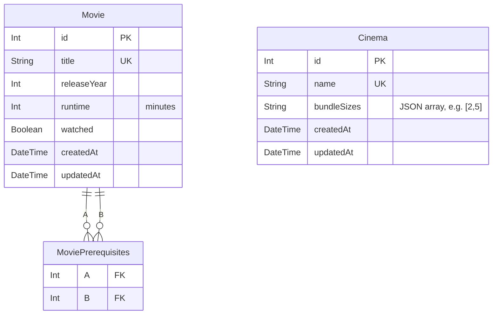

# Doomsday Ready

A full-stack app that helps MCU fans plan the prerequisite rewatch before *Avengers: Doomsday*, and work out the exact cinema bundle combination for an opening-night watch party.

Built for the Blinto Talent Accelerator 2027 Full Stack Developer Internship assessment.

## Features

**Movie management**
- Create and list movies; edit title, year, runtime and prerequisites.
- Mark movies as watched (optimistic update, rolled back if the request fails).
- Search plus All / Watched / Unwatched filters.
- Input validation on every write; circular prerequisites are rejected.

**Rewatch planning**
- Walks the prerequisite chain recursively and returns a valid viewing order.
- A movie shared by several chains appears once.
- The selected movie itself is not part of its plan.
- Reports watched count and remaining watch time (unwatched prerequisites only).

**Cinema booking**
- Create cinemas with their available bundle sizes.
- Finds the fewest bundles that add up to exactly the group size and returns the breakdown.
- Reports when no exact combination exists.

**Frontend**: one page, three views: *Movie database*, *Rewatch protocol*, *Cinema booking*. Dark theme with red accents, local poster artwork (with a plain title card fallback), responsive down to phone width.

## Tech stack

| Technology | Role |
|---|---|
| Next.js 16 (App Router) | Pages and API route handlers |
| React 19 | UI |
| TypeScript | Types across API and UI |
| Prisma 6 | Schema, migrations, database access |
| SQLite | Local database (single file) |
| Zod 4 | Request validation |
| Tailwind CSS 4 | Styling |
| Motion | View transitions and small animations |
| lucide-react | Icons |
| tsx + Node's built-in test runner | Running the tests |

No graph, pathfinding or optimization libraries are used. Both algorithms are plain TypeScript in `src/lib/algorithms/`.

## Project structure

```
prisma/
  schema.prisma          Movie and Cinema models
  migrations/            SQL migrations
  seed.ts                Sample movies and cinemas (idempotent)
public/posters/          Local poster images
src/
  app/
    page.tsx, layout.tsx
    api/
      movies/route.ts                      GET, POST
      movies/[id]/route.ts                 PATCH
      movies/[id]/rewatch-order/route.ts   GET
      cinemas/route.ts                     GET, POST
      cinemas/[id]/booking/route.ts        GET
  lib/
    algorithms/
      rewatch-order.ts   DFS plan + cycle check
      booking.ts         Minimum-bundle dynamic programming
    validations/         Zod schemas
    movies.ts            Prerequisite validation (404 / 409)
    api.ts               Error -> JSON response mapping
    prisma.ts            Prisma client
    client.ts            Browser-side fetch wrapper
  components/            DoomsdayApp, movies/, rewatch/, booking/, layout/, ui/
tests/
  algorithms.test.ts     31 unit tests
  api.test.ts            23 API tests
Dockerfile, docker-compose.yml, .dockerignore
DEMO.md                  Demo walkthrough
INTERVIEW_NOTES.md       Plain-language notes on how it works
```

## Getting started

Prerequisites: Node.js 20.9 or newer (developed on Node 24) and npm.

```bash
git clone https://github.com/rocketom24/doomsday-ready.git
cd doomsday-ready
npm install
cp .env.example .env        # on Windows PowerShell: Copy-Item .env.example .env
npm run db:generate         # generate the Prisma client
npm run db:migrate          # create prisma/dev.db and apply migrations
npm run db:seed             # sample data, safe to run again
npm run dev                 # http://localhost:3000
```

Other scripts: `npm run build`, `npm start`, `npm run lint`, `npm test`.

### Environment variables

| Variable | Required | Example |
|---|---|---|
| `DATABASE_URL` | yes | `file:./dev.db` |

SQLite is the only database. The path is relative to `prisma/schema.prisma`, so `file:./dev.db` is `prisma/dev.db`. `.env` is git-ignored; `.env.example` is the template.

### Docker

```bash
docker compose up --build
```

Then open http://localhost:3000. The container applies the migrations and seeds the sample data on its first start. The SQLite file lives in a named volume (`doomsday-data`, mounted at `/data`), separate from your local `prisma/dev.db`.

```bash
docker compose stop        # stop, keep the data
docker compose down        # remove the container, keep the data volume
docker compose down -v     # remove the container AND the database volume (deletes all data)
```

> The Docker files were written and reviewed carefully, but they were **not built or run** on the machine this project was developed on (Docker was not installed there). The commands the container runs on startup (`prisma migrate deploy`, `prisma db seed`, `next start`) were run directly against a throwaway database and worked.

## API reference

All errors use one shape: `{ "error": { "code": "...", "message": "..." } }`.

| Method | Endpoint | Purpose | Input |
|---|---|---|---|
| GET | `/api/movies` | List movies (by year, then title) with `prerequisites` and `dependents` | none |
| POST | `/api/movies` | Create a movie (201) | body: `title`, `releaseYear`, `runtime`, optional `prerequisites` (ids), optional `watched` |
| PATCH | `/api/movies/:id` | Update a movie | body: any of the same fields, at least one. `prerequisites` replaces the whole list; omitting it leaves it unchanged |
| GET | `/api/movies/:id/rewatch-order` | Rewatch plan for that movie | none |
| GET | `/api/cinemas` | List cinemas, `bundleSizes` as an array | none |
| POST | `/api/cinemas` | Create a cinema (201) | body: `name`, `bundleSizes` (1-10 unique integers, each 1-500) |
| GET | `/api/cinemas/:id/booking?groupSize=N` | Minimum-bundle booking | query: `groupSize`, integer 1-10000 |

Validation rules: title is trimmed and required and must be unique; `releaseYear` is an integer from 1888 to 2100; `runtime` is an integer from 1 to 300 (minutes); prerequisite ids must be unique positive integers.

| Status | Code | When |
|---|---|---|
| 400 | `VALIDATION_ERROR` | Bad JSON, bad id, bad fields, duplicate prerequisite ids, empty PATCH, bad `groupSize` |
| 404 | `NOT_FOUND` | Movie or cinema does not exist, or a prerequisite id does not exist |
| 409 | `DUPLICATE_TITLE` / `DUPLICATE_CINEMA` | Unique name already taken |
| 409 | `CIRCULAR_DEPENDENCY` | The prerequisites would create a cycle (including a movie requiring itself) |
| 500 | `INTERNAL_SERVER_ERROR` | Unexpected error, or a cinema whose stored bundle data is corrupted |

Rewatch plan response (`GET /api/movies/8/rewatch-order`, shortened):

```json
{
  "target": { "id": 8, "title": "Avengers: Doomsday" },
  "movies": [{ "id": 1, "title": "Iron Man", "releaseYear": 2008, "runtime": 126, "watched": false }],
  "totalMovies": 7, "watchedCount": 0, "unwatchedCount": 7, "remainingRuntime": 1000
}
```

Booking response (`GET /api/cinemas/2/booking?groupSize=11`):

```json
{
  "cinema": { "id": 2, "name": "Star Cineplex Jamuna Future Park", "bundleSizes": [2, 5] },
  "groupSize": 11, "possible": true, "totalBundles": 4, "totalSeats": 11,
  "bundles": [{ "size": 5, "count": 1 }, { "size": 2, "count": 3 }]
}
```

**Impossible bookings are not errors.** If no exact combination exists, the API still answers 200 with `"possible": false`, `totalBundles: null`, `totalSeats: null`, `bundles: []` and a `message`. The question was valid, and "no" is a valid answer.

Circular dependency example: with the seed data, `PATCH /api/movies/1` with `{"prerequisites":[8]}` (Iron Man requiring Doomsday) returns 409 `CIRCULAR_DEPENDENCY`, and nothing is saved.

## Algorithms

### A. Rewatch order and cycle detection

Source: [src/lib/algorithms/rewatch-order.ts](src/lib/algorithms/rewatch-order.ts)

**The graph.** Each movie is a node. "Movie X requires movie Y" is an arrow from X to Y. A chain such as Iron Man → The Avengers → Civil War means Iron Man must be watched before The Avengers, which must be watched before Civil War. Finding everything you need to watch for a target is "follow all arrows from the target", which is graph traversal.

**The idea (depth-first search).** To plan movie M: first plan every prerequisite of M, then add M itself. Each prerequisite is planned the same way, so this is naturally recursive.

```
visit(M):
    if M is already in the plan: stop
    for each prerequisite P of M: visit(P)
    add M to the plan
```

Because M is added only after all of its prerequisites have been added, every movie lands after the things it needs. That is what makes the order valid.

**Shared prerequisites.** In the seed data, *The Avengers* requires both Iron Man and Captain America: The First Avenger. Suppose another movie also needed Iron Man. When the traversal reaches Iron Man a second time, it is already in the `done` set, so `visit` returns immediately. Each movie is in the output once.

**Walkthrough for Doomsday.** Doomsday needs Endgame, which needs Infinity War, which needs Civil War and Thor: Ragnarok. Civil War needs The Avengers, which needs Iron Man and Captain America: The First Avenger. The traversal reaches Iron Man first and adds it, then Captain America, then The Avengers, Civil War, Thor: Ragnarok, Infinity War, Endgame, and finally Doomsday itself. Output order:

1. Iron Man
2. Captain America: The First Avenger
3. The Avengers
4. Captain America: Civil War
5. Thor: Ragnarok
6. Avengers: Infinity War
7. Avengers: Endgame

**Excluding the target.** The target is always the last movie added (it is visited first but finishes last), so the code removes it with `order.pop()`. The plan is "what to watch before it".

**Progress and runtime.** After the plan is built, movies with `watched = false` are filtered out. `watchedCount` is the plan length minus that number, and `remainingRuntime` is the sum of the runtimes of the unwatched ones. For the seed data with nothing watched: 7 movies, 1000 minutes.

**Cycle detection.** Before saving prerequisites for movie M, the API checks each proposed prerequisite P with `dependsOn(P, M)`: starting at P and following its prerequisites, can we reach M? If yes, then M already (indirectly) needs P's chain, and making P a prerequisite of M closes a loop. A movie listed as its own prerequisite is rejected as well. Example: Doomsday already depends on Iron Man through the chain above, so making Iron Man require Doomsday is rejected with 409. The check and the write run inside one database transaction, so a rejected request changes nothing.

**Why cycles are fatal.** If A needs B and B needs A, neither can go first, so no valid order exists. The check exists so that this state can never be saved. As a second line of defence, `buildRewatchPlan` also tracks an `inProgress` set; if it ever meets a movie it is already in the middle of planning, it throws `CircularDependencyError` (409) instead of recursing forever.

**Complexity.** `V` = number of movies, `E` = number of prerequisite links.
- Plan: each movie is expanded once and each link followed once, so time is **O(V + E)**. Space is **O(V)** for the sets, the output and the recursion depth (the longest chain).
- Cycle check: one traversal is **O(V + E)** time and **O(V)** space; it runs once per proposed prerequisite. Building the lookup map from all movies adds another O(V + E).

### B. Cinema bundle optimization

Source: [src/lib/algorithms/booking.ts](src/lib/algorithms/booking.ts)

**The problem.** A cinema sells seats only in fixed bundle sizes (for example 2 and 5). Given a group size, find the combination of bundles that adds up to exactly that many seats using the fewest bundles. Bundles can be used more than once.

**Why not greedy.** The obvious approach is to take the biggest bundle that fits, repeatedly. With bundles `[2, 5]` and 11 people: take 5, take 5 (10 seats), and now 1 seat is left that no bundle can fill. Greedy gives up, yet `5 + 2 + 2 + 2 = 11` works. It can also give a worse answer rather than none: with `[1, 3, 4]` and 6 people, greedy picks `4 + 1 + 1` (3 bundles), but `3 + 3` needs only 2. Both cases are in the tests. Greedy makes a choice early and never reconsiders it.

**Dynamic programming.** Instead of guessing, answer the question for every size from 0 up to the group size, reusing earlier answers.

- `fewest[n]` = the fewest bundles needed to make exactly `n` seats, or "impossible" (stored as `Infinity`).
- Start: `fewest[0] = 0` (zero seats need zero bundles).
- For each `n` from 1 to the group size, try every bundle size `s` that is not larger than `n`. If `n - s` seats can be made, then `n` can be made with one more bundle:

  `fewest[n] = 1 + min(fewest[n - s])`

- Whenever a size gives a better answer than the current one, remember it in `lastBundle[n]` (the last bundle used for `n`).

**Trace for sizes 2 and 5.**

| n | 0 | 1 | 2 | 3 | 4 | 5 | 6 | 7 | 8 | 9 | 10 | 11 |
|---|---|---|---|---|---|---|---|---|---|---|---|---|
| fewest[n] | 0 | impossible | 1 | impossible | 2 | 1 | 3 | 2 | 4 | 3 | 2 | 4 |
| lastBundle[n] | | | 2 | | 2 | 5 | 2 | 2 | 2 | 2 | 5 | 2 |

For 11: using a 2 leaves 9 (`fewest[9] = 3`, so 4 total); using a 5 leaves 6 (`fewest[6] = 3`, so 4 total). Both give 4 bundles. The code keeps the first one it finds, a bundle of 2.

**Rebuilding the answer.** Start at the group size and follow `lastBundle` backwards: 11 uses a 2, leaving 9; 9 uses a 2, leaving 7; 7 uses a 2, leaving 5; 5 uses a 5, leaving 0. The counts are one 5 and three 2s, which is `5 + 2 + 2 + 2 = 11` using 4 bundles. The result is sorted largest bundle first.

**Impossible sizes.** If `fewest[groupSize]` is still `Infinity` after filling the table, no exact combination exists and the function returns `null`. The API turns that into `"possible": false`. Size 1 with bundles `[2, 5]` is an example.

When several combinations tie for fewest bundles, any one of them may be returned.

**Complexity.** `G` = group size, `B` = number of bundle sizes. The loop does at most `B` checks for each of the `G` values: time **O(G × B)**. The two arrays have `G + 1` entries: space **O(G)**. The API caps `G` at 10000 and `B` at 10, so this is at most about 100,000 steps.

## Data model



`MoviePrerequisites` is the join table Prisma creates for the implicit many-to-many relation (`_MoviePrerequisites` in SQLite). It is not a model in `schema.prisma`. `Cinema` has no relations to the other tables.

- **Self-reference.** A prerequisite is just another movie, so the relationship points from `Movie` back to `Movie` (`prerequisites` and `dependents` are the two sides). No separate "prerequisite" entity is needed.
- **Many-to-many.** One movie can require several movies (The Avengers requires two), and one movie can be required by several others. A foreign key on `Movie` could only express one parent, so a join table is needed. The join table has a unique index on the pair, so a link cannot be stored twice, and rows are deleted automatically if either movie is deleted.
- **Bundle sizes as a JSON string.** SQLite has no array type, and bundle sizes are always read and written together as a small list, never queried individually. Storing `"[2,5]"` in one column avoids a second table. The trade-off: the database cannot enforce that the values are positive integers, so the API validates on write (Zod) and parses defensively on read; a malformed row returns 500 for booking and is skipped in the cinema list. A `CinemaBundle` table would be the stricter design if bundle sizes ever needed to be queried.

## Testing

```bash
npm test      # 54 tests, about 3 seconds
npm run lint
npm run build
```

**Algorithm tests** (`tests/algorithms.test.ts`, 31 tests):
- Booking: results compared against an independent brute-force search for every group size up to 150, greedy-failure cases, impossible sizes, group sizes 1 and 10000, large bundle sizes.
- Rewatch order: chains, diamond-shaped shared prerequisites, target exclusion, watched counts and runtime, cycle detection, and a corrupted (already cyclic) graph.

**API tests** (`tests/api.test.ts`, 23 tests): call the real route handlers for movies, rewatch order, cinemas and booking: validation errors, duplicate titles/names, 404s, 409 cycles (and that a rejected update leaves the data unchanged), impossible bookings, a cinema with corrupted bundle data.

**Database isolation.** The API tests create a temporary SQLite file in the OS temp folder, apply the real migrations to it with `prisma migrate deploy`, and delete it afterwards. `prisma/dev.db` is never opened.

**Manual QA only.** The UI was checked by hand in a browser (filters, forms, cycle error, optimistic rollback, rewatch plan, booking, widths from 320 to 1280px). There are no automated UI or browser tests.

## Sample data

`npm run db:seed` loads 8 movies and 4 cinemas. Running it again does not duplicate anything, and it does not change the `watched` flag.

- Movies: Iron Man, Captain America: The First Avenger, The Avengers, Captain America: Civil War, Thor: Ragnarok, Avengers: Infinity War, Avengers: Endgame, Avengers: Doomsday.
- The prerequisite links are sample data chosen for this demo. They are **not** an official Marvel viewing guide.
- **The runtime of Avengers: Doomsday (180 minutes) is a placeholder, not the official runtime.**
- Cinemas (bundle sizes): Bashundhara City Complex `[1, 3, 4]`, Jamuna Future Park `[2, 5]`, Centerpoint `[6, 9, 20]`, SKS Tower `[4, 6]`.

More notes: [DEMO.md](DEMO.md) for a 3-5 minute walkthrough, [INTERVIEW_NOTES.md](INTERVIEW_NOTES.md) for plain-language explanations of the design.

## AI assistance disclosure

I used AI tools while building this project, mainly Claude Code (Anthropic). It helped with planning and reviewing the structure, writing the API routes, the frontend, the tests and this documentation, and with debugging and suggesting test cases.

That includes the two core algorithms. Claude Code was involved in writing the rewatch-order/cycle-detection code and the minimum-bundle dynamic programming code, so they should not be read as solo work written without AI help. What I can say accurately is that neither algorithm uses a graph, pathfinding or optimization library; both are plain TypeScript with no algorithm-solving dependencies. I reviewed the code, ran it, and checked it with the test suites (including the brute-force comparison for the booking algorithm) and manual testing.
